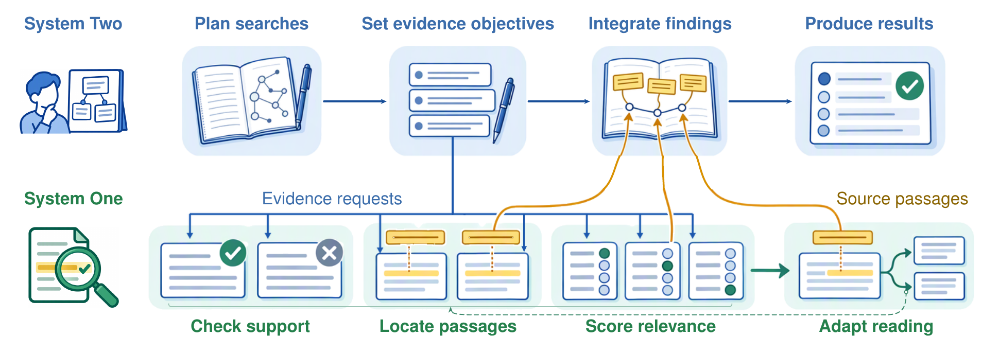
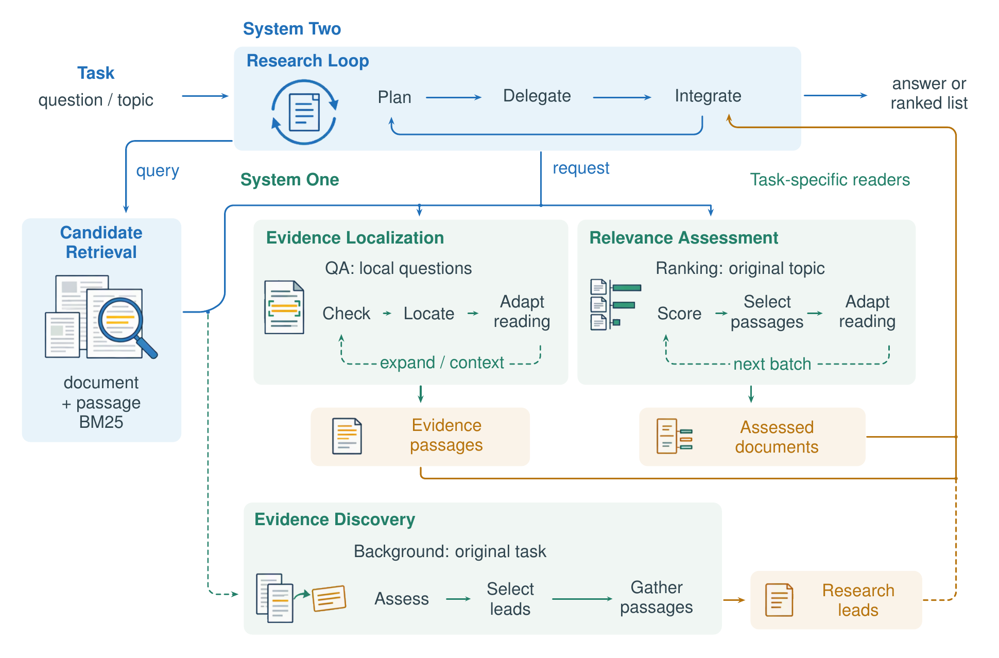
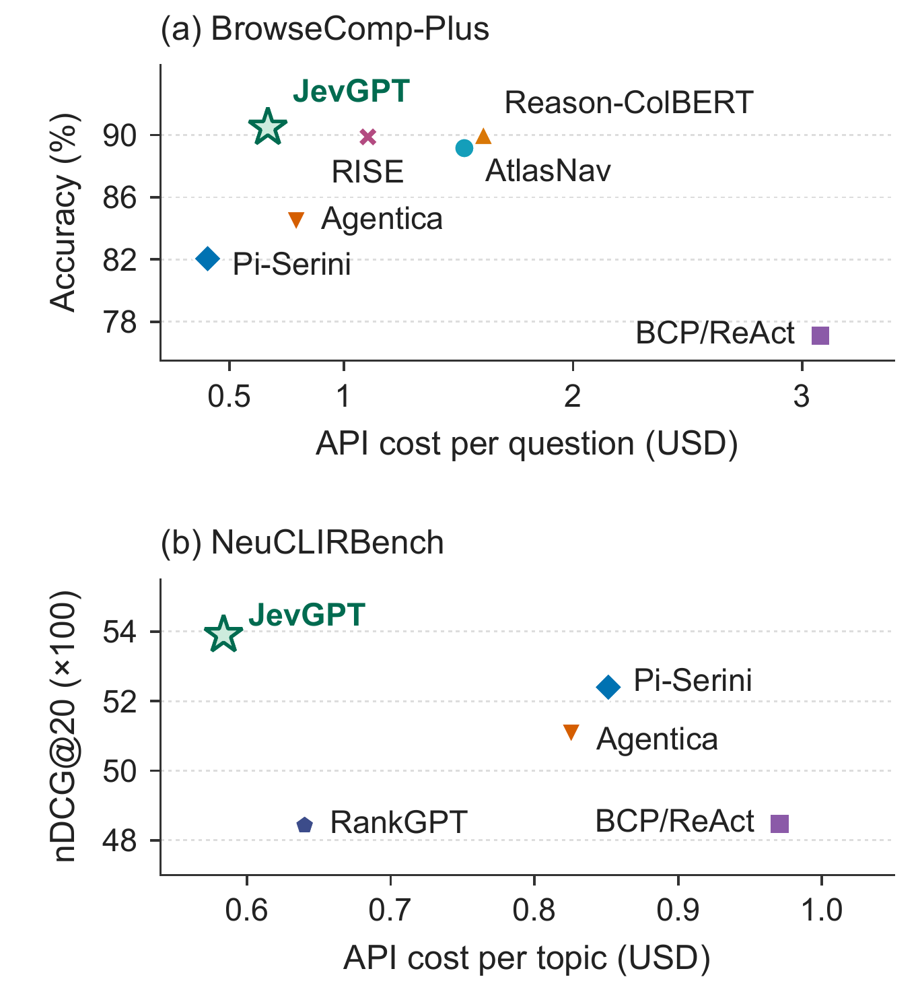
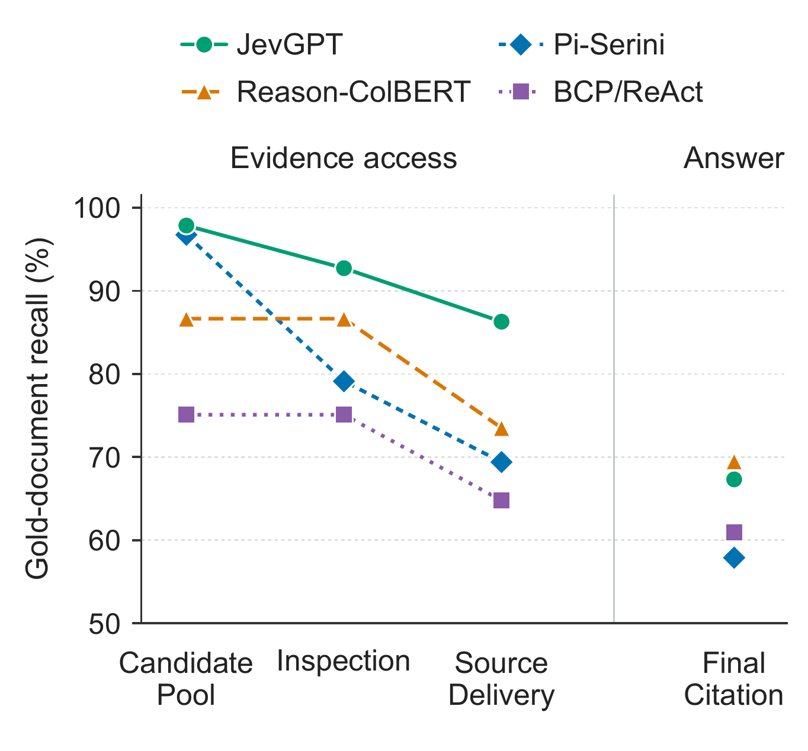

<p align="center">
  
</p>

<h1 align="center">JevGPT: Thinking Fast and Slow in Autonomous Research</h1>

<p align="center">
  Yasheng Sun · Yanning Dai · Yimeng Chen · Nanbo Li · Firas Laakom · Yifan Xu ·
  Piotr Piękos · Mateusz Ostaszewski · Wenyi Wang · Cheng Luo · Yuhui Wang · Jürgen Schmidhuber
  <br>
  King Abdullah University of Science and Technology (KAUST)
</p>

<p align="center">
  <a href="https://arxiv.org/abs/2610.18272"></a>
  <a href="https://huggingface.co/papers/2610.18272"></a>
  <a href="https://sunyasheng.github.io/projects/JevGPT.html"></a>
  <a href="#-code-release"></a>
</p>

<p align="center">
  <a href="#-tldr">TL;DR</a> ·
  <a href="#-how-jevgpt-works">Method</a> ·
  <a href="#-results">Results</a> ·
  <a href="#-code-release">Code</a> ·
  <a href="#-citation">Citation</a>
</p>

---

## 🔥 News

- **2026-10-14** · The paper is on [arXiv](https://arxiv.org/abs/2610.18272) and [Hugging Face Papers](https://huggingface.co/papers/2610.18272). Code and per-item records are being prepared for release.

## 💡 TL;DR

Research agents built on a single autoregressive LLM spend the same heavy computation on every step, from planning down to small local decisions about whether a source is relevant. **JevGPT** splits these roles. A deliberative LLM (**System Two**, GPT-5.5) sets evidence objectives and integrates findings. A fast judgment model (**System One**, Jev) inspects many sources in parallel, locates support and returns only the selected original passages. On BrowseComp-Plus and NeuCLIRBench, JevGPT reaches the highest observed task performance among the compared agents, with faster completion and lower API cost than comparably effective research agents.

<p align="center">
  
  <br>
  <em><b>Figure 1.</b> System Two plans searches and integrates findings; System One guides parallel evidence inspection and returns source passages.</em>
</p>

## 🧠 How JevGPT works

| | ⚡ **System One** (Jev) | 🧭 **System Two** (GPT-5.5) |
| --- | --- | --- |
| Role | Fast, bounded local judgments | Deliberative research planning |
| Reads | One source region at a time, under an explicit evidence objective | The accumulated investigation |
| Decides | Does this source support the request? Where is the passage? Read further? | What to search next, what evidence to request, when to answer |
| Runs | Many judgments in parallel | One reasoning thread |

Evidence requests flow from System Two to System One. Selected original passages, with source coordinates, flow back and inform the next research step. Proactive discovery lets System One inspect further retrieved candidates while System Two keeps working.

<p align="center">
  
  <br>
  <em><b>Figure 2.</b> Overview of evidence acquisition, localization, adaptive reading and discovery in JevGPT.</em>
</p>

## 📊 Results

**BrowseComp-Plus** · 830 questions

| Method | Accuracy (%) ↑ | Time (s) ↓ | Cost ($) ↓ |
| --- | ---: | ---: | ---: |
| BCP/ReAct | 77.11 | 182.1 | 3.0798 |
| Pi-Serini | 82.05 | 112.6 | 0.4053 |
| Agentica | 84.46 | 111.7 | 0.7919 |
| AtlasNav | 89.16 | 144.0 | 1.5257 |
| RISE | 89.88 | 111.0 | 1.1050 |
| Reason-ColBERT | 90.00 | 136.2 | 1.6090 |
| **JevGPT** | **90.48** | **91.7** | 0.6681 |

**NeuCLIRBench** · 105 topics

| Method | nDCG@20 ↑ | Time (s) ↓ | Cost ($) ↓ |
| --- | ---: | ---: | ---: |
| BM25 | 0.3608 | – | – |
| Qwen3-Reranker | 0.5138 | – | – |
| RankGPT | 0.4843 | 141.3 | 0.6402 |
| BCP/ReAct | 0.4847 | 186.8 | 0.9707 |
| Agentica | 0.5107 | 211.0 | 0.8256 |
| Pi-Serini | 0.5240 | 177.0 | 0.8515 |
| **JevGPT** | **0.5390** | **79.3** | **0.5838** |

Time and cost are per-question or per-topic means from the paper. Cost covers both systems: GPT-5.5 at medium effort for System Two and Jev-1.13.0 for System One. The full tables with retrievers, tokens, searches and the per-system cost split are in the [paper](https://arxiv.org/abs/2610.18272).

<p align="center">
  
  &nbsp;
  
  <br>
  <em><b>Left:</b> quality versus API cost (upper left is better). <b>Right:</b> how gold evidence reaches the research loop on BrowseComp-Plus.</em>
</p>

## 🚧 Code release

We are reviewing the code before it goes public. This repository will contain:

- [ ] The research runtime and the JevGPT evidence readers for System One
- [ ] Frozen configurations for BrowseComp-Plus and NeuCLIRBench
- [ ] Per-item records that rebuild the JevGPT rows of Tables 1 and 2 without any model calls
- [ ] Evaluation scripts and a step-by-step reproduction guide

⭐ Star or watch this repository to be notified when the code is released.

## 📝 Citation

If you find JevGPT useful, please cite:

```bibtex
@article{sun2026jevgpt,
  title   = {{JevGPT}: Thinking Fast and Slow in Autonomous Research},
  author  = {Sun, Yasheng and Dai, Yanning and Chen, Yimeng and Li, Nanbo
             and Laakom, Firas and Xu, Yifan and Pi{\k{e}}kos, Piotr
             and Ostaszewski, Mateusz and Wang, Wenyi and Luo, Cheng
             and Wang, Yuhui and Schmidhuber, J{\"u}rgen},
  journal = {arXiv preprint arXiv:2610.18272},
  year    = {2026}
}
```

## 🙏 Acknowledgments

JevGPT builds on [Pi-Serini](https://github.com/justram/pi-serini), [BrowseComp-Plus](https://github.com/texttron/BrowseComp-Plus) and [NeuCLIRBench](https://arxiv.org/abs/2511.14758), and uses Jev, the System One model from [TypeSafe AI](https://typesafe.ai/blog/introducing-system-one-models-and-jev).
